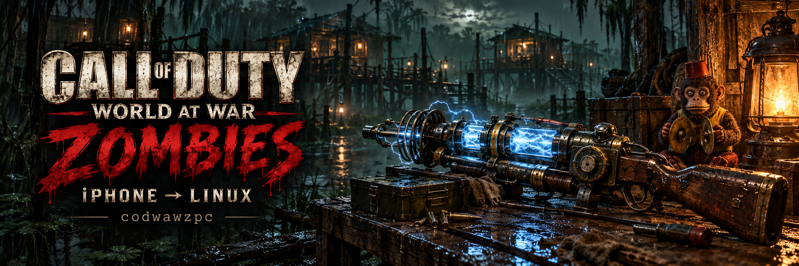
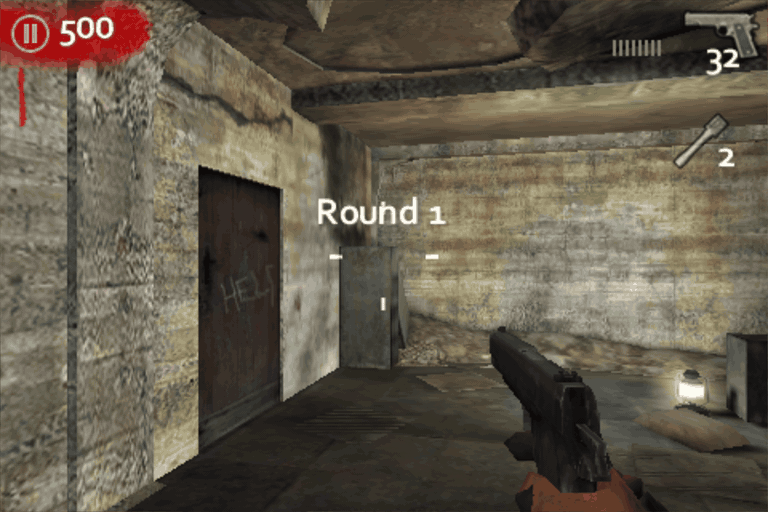
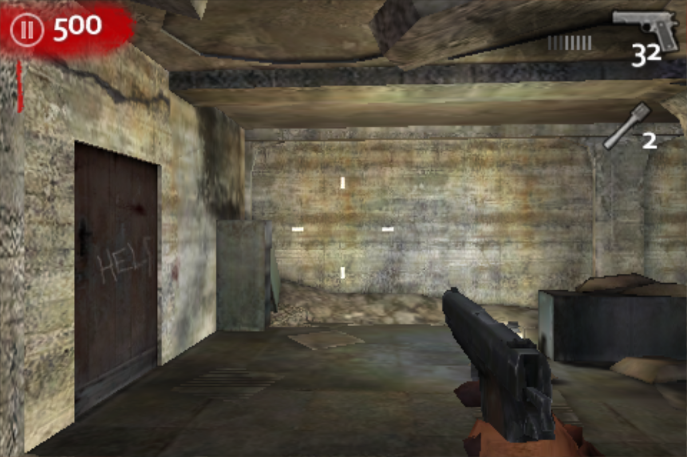
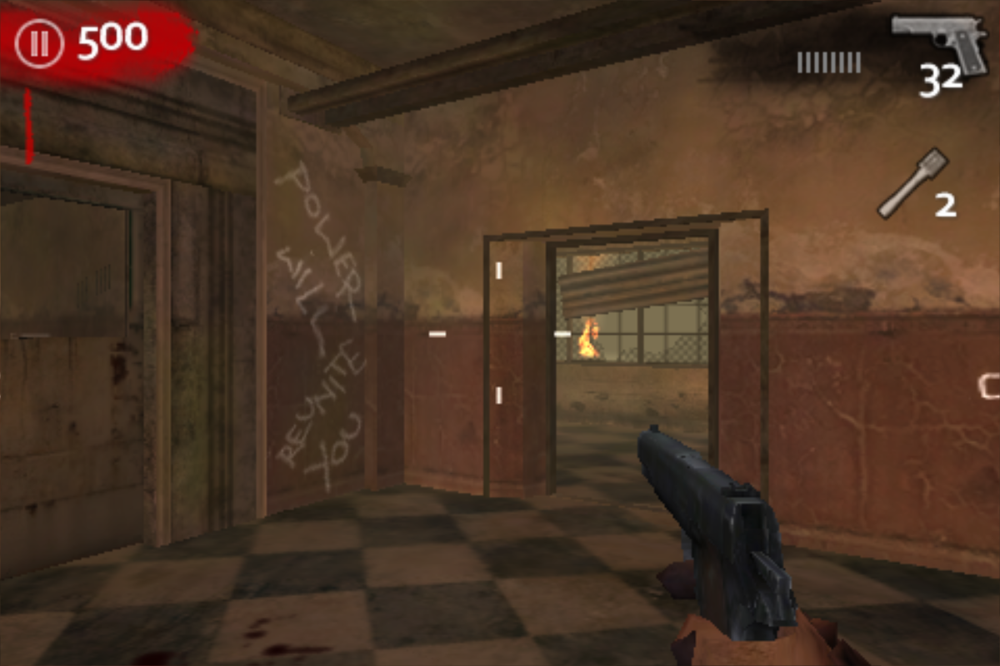
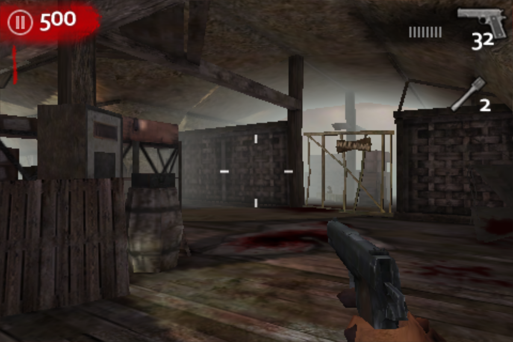
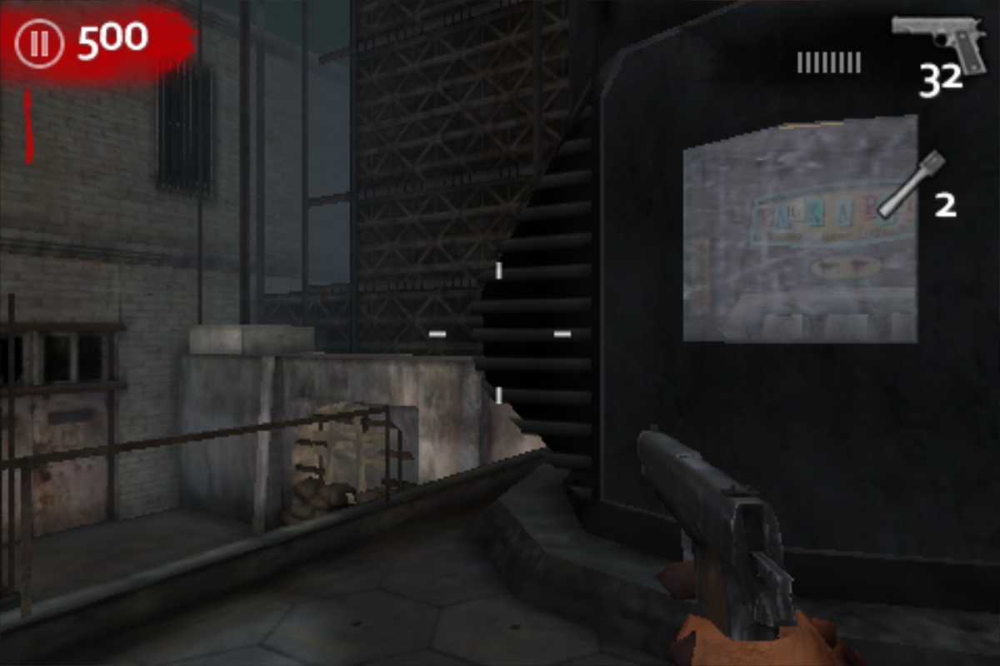
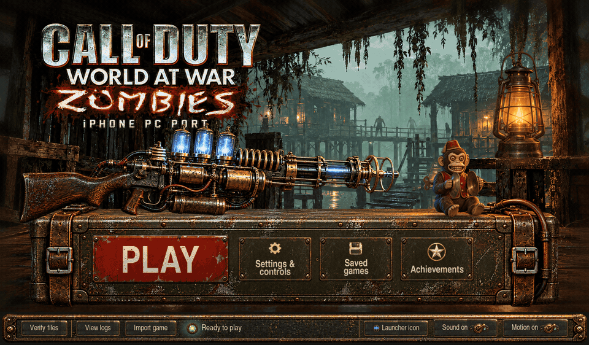
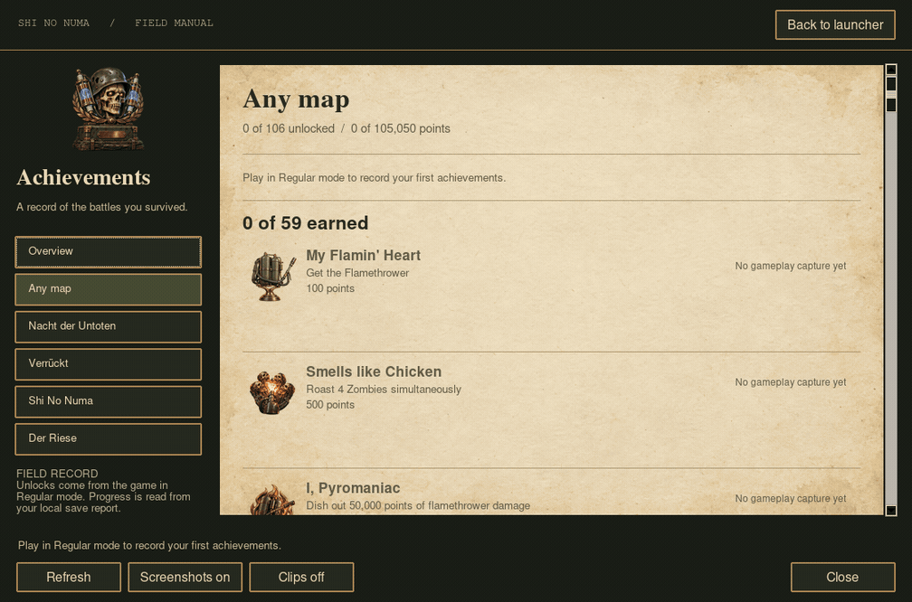
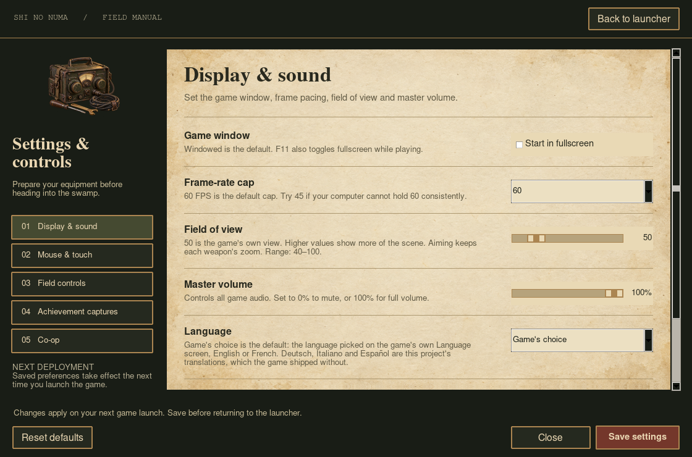
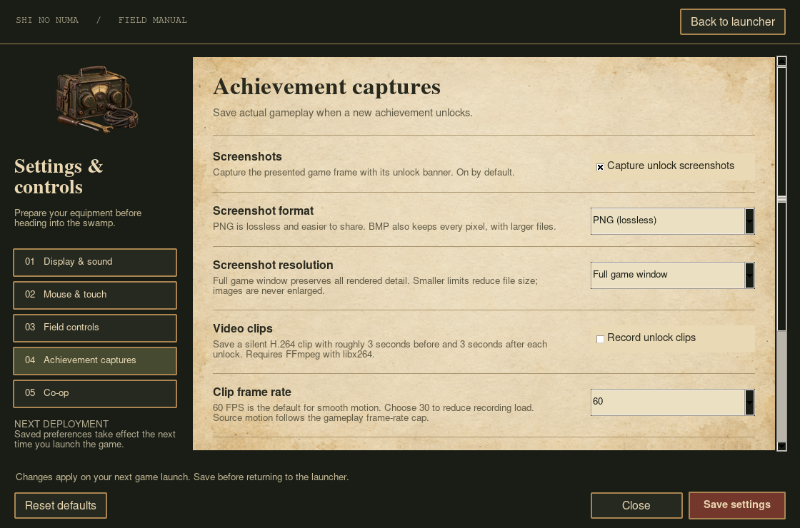

# codwawzpc — Call of Duty: Zombies (iPhone) for Linux

`codwawzpc` runs the original iPhone release of **Call of Duty: World at War:
Zombies, version 1.5.0** on Linux x86_64, with keyboard and mouse controls. It
is a compatibility host based on [touchHLE](https://touchhle.org/): the
game's own ARM executable runs under Dynarmic, while the host provides the
iPhone OS services it expects. It is not a decompilation or a remake.

**Bring your own game.** No game files are included or downloaded. You need an
unencrypted IPA of the iPhone build `com.activision.callofduty` version 1.5.0
(all four maps: Nacht der Untoten, Verrückt, Shi No Numa and Der Riese).

This is an experimental preservation project. See [Status](#status) for what
has and has not been verified.

Generated artwork and the reviewed documentation captures below are included.
Personal captures, game files, downloaded reference images and private
development files stay local.
See [source publication policy](SOURCE_POLICY.md).

## Gameplay



Fresh footage from the actual Linux host, recorded with disposable saves.
The GIF is silent; game audio plays normally in the application.

<details>
<summary>Screenshots from all four maps</summary>

| Nacht der Untoten | Verrückt |
| --- | --- |
|  |  |

| Shi No Numa | Der Riese |
| --- | --- |
|  |  |

</details>

## Launcher preview



The launcher uses generated artwork with live native controls. This preview
uses demo readiness and empty progress. [Full-size screenshot](docs/media/launcher.png).

<details>
<summary>Achievement browser, settings and capture controls</summary>



| Display & sound | Achievement captures |
| --- | --- |
|  |  |

[Achievement screen screenshot](docs/media/achievements.png) ·
[Media provenance and capture instructions](docs/media/README.md)

</details>

## Download and play

Download the Linux x86_64 archive from [Releases](https://github.com/aurelioochoa/codwawzpc/releases), extract it to a writable folder, and open `Launch` (or run `./Launch` in a terminal). The launcher imports your own Call of Duty: Zombies iPhone 1.5.0 IPA; game files are not included. Press Escape, Enter, Space or left-click to skip the intro movie. The portable build bundles Python, Tk, Pillow and FFmpeg. It requires glibc 2.35 or newer, an X11 desktop or XWayland, a working OpenGL 2.1 driver and desktop audio.

Everything the game writes is in the extracted folder's `userdata` directory. Close the launcher before moving the folder. For an update, extract the new release separately and copy `userdata` to it. Existing XDG installations are not migrated automatically: use Saved games → Export in the old installation and Import in the new one. Back up your save first. To add a desktop-menu entry, run `./Launch --install-desktop`; repeat after moving the folder.

To build the portable archive from a checkout with Docker, run `scripts/build_portable.sh`. The image pins the Ubuntu base, package snapshot and Rust version; the archive contains the package manifest and license notices. See [portable instructions](packaging/linux/PORTABLE.md).

## Source build requirements

- Linux x86_64 with a graphical desktop and OpenGL 2.1 or later.
- Rust, a C/C++ toolchain, CMake, Boost headers and `pkg-config`.
- FFmpeg on `PATH`, for the intro movie.
- For the native launcher: Python 3.10+, Tk and Pillow (`launcher/requirements.txt`).

See [dev-docs/building.md](dev-docs/building.md) for platform packages.

## Quick start

```sh
git clone https://github.com/aurelioochoa/codwawzpc.git
cd codwawzpc
git submodule update --init --recursive
make build
./target/release/codwawzpc import /path/to/COD_Zombies_1.5.0.ipa
./target/release/codwawzpc run
```

`make help` lists the other targets.

## Native launcher

Run `make dev` (or `make launcher`) to build and open the Shi No Numa
field-radio launcher. Once built, `./target/release/codwawzpc launcher` opens
it directly. Import game opens a native IPA picker; Play becomes available
after the host verifies the installation. Settings & controls edits the same
preferences used by the CLI, and Saved games lists the save files and exports
or imports your saved game. The footer's Launcher icon button switches between
four generated icons and remembers your choice, including a Mystery Box emblem
with the game's special weapons.

Run `make install-desktop` to add **Call of Duty: Zombies** to your Linux
applications menu. Its menu icon follows the launcher's selected icon.

See [launcher setup and behavior](launcher/README.md) and
[native launcher verification](docs/launcher/README.md).

Achievement clips support smooth **60 FPS H.264 recording with stereo game audio**,
with configurable resolution and compression quality in **Settings → Achievement captures**.
Screenshots default to lossless PNG at the full game window size. Clips require
FFmpeg with `libx264` and AAC; see [capture settings](launcher/README.md).
`make run` continues to launch the game directly.

## Commands

```text
codwawzpc launcher            Open the native launcher
codwawzpc import <game.ipa>   Validate and install your copy of the game
codwawzpc check               Verify the installed game files
codwawzpc run [options]       Play
codwawzpc export-save <file>  Copy your saved game to a file
codwawzpc import-save <file>  Replace your saved game with a file
codwawzpc reset-save          Delete your saved game and start over
                              (--no-backup skips the backup)
codwawzpc --help | --version | --copyright
```

`run` options (all but `--fps` are remembered for next time):

| Option | Effect |
| --- | --- |
| `--fullscreen`, `--windowed` | Window mode (F11 toggles while playing) |
| `--controls=desktop` | Keyboard and mouse (default) |
| `--controls=touch` | Original touch controls; the mouse is a finger |
| `--sensitivity=<n>` | Mouse look speed, 0.05–20 (default 1) |
| `--invert-y`, `--no-invert-y` | Vertical mouse look direction |
| `--frame-rate=60`, `--frame-rate=45` | Gameplay frame-rate cap (default 60; the game's own is 45) |
| `--fov=<degrees>` | Field of view, 40–100 (default 50, the game's own); aiming keeps each weapon's zoom |
| `--render-scale=1`, `2`, `3`, `4` | Internal rendering resolution as a multiple of 480×320 (default 1, the game's own). See [Graphics](#graphics) |
| `--widescreen=off`, `16:10`, `16:9` | Give the game a wider screen (default off, the original 3:2) |
| `--texture-filter=original`, `trilinear`, `2x`, `4x`, `8x`, `16x` | Filtering of the game's mipmapped world textures (default original) |
| `--gamma=<n>`, `--contrast=<n>`, `--sharpening=<n>` | Picture adjustments: gamma 0.5–2, contrast 0.5–1.5, sharpening 0–1 (defaults 1, 1 and 0: the original picture) |
| `--picture=original` | Reset gamma, contrast and sharpening to the original picture |
| `--auto-aim=off`, `low`, `medium`, `high` | Aim assist (default off: the view is never pulled toward zombies); low, medium and high are the game's own Auto-Aim levels, which it replaces |
| `--logos`, `--no-logos` | Show the Activision, Treyarch and Ideaworks logos at startup (default off: the title screen comes about 8 seconds sooner) |
| `--language=german`, `italian`, `spanish`, `english`, `french`, `game` | Language at startup (default `game`: the one chosen on the game's own Language screen). German, Italian and Spanish are this project's translations; see [Languages](#languages) |
| `--coop-server=<host:port>` | Enable co-op through your relay server; an empty value disables it (default off) |
| `--player-name=<name>` | Relay player name (default: your OS username) |
| `--fps` | Print measured frame rates |

The game's own Options → Controls screen (sensitivity, invert Y) also
applies and is saved by the game; its Auto-Aim option is replaced by
`--auto-aim`.

## Graphics

Every graphics option defaults to the game's original look; the launcher's
Settings → Graphics page sets the same options.

- **Render scale** renders the game at 2×, 3× or 4× its 480×320, independent
  of the window size. In a large window this sharpens geometry, weapons and
  text. When the scale exceeds the window, the frame is averaged down, which
  smooths edges (supersampling). On the test machine (Radeon RX 6700S) 2× and
  3× held 60 FPS in Nacht der Untoten; 4× dipped to about 54 FPS.
- **Widescreen** gives the game a 16:10 (512×320) or 16:9 (568×320) screen.
  The game lays levels out for it: more of the scene shows at the sides, with
  the same vertical view, and the HUD moves to the screen edges. Menus keep
  their 3:2 arrangement, with their backgrounds, title bars and info panels
  widened to the screen. Experimental: verified in Nacht der Untoten solo
  play and the front-end and pause menus with keyboard controls.
- **Texture filtering**: the game samples its world textures with bilinear
  filtering and visible steps between detail levels. Trilinear blends the
  levels; anisotropic filtering also keeps floors and walls sharp at an
  angle. Menus and HUD are unchanged.
- **Gamma, contrast and sharpening** adjust the presented picture, HUD
  included. Sharpening is limited to avoid halos. `--picture=original`, or
  Original picture in the launcher, restores the original picture.

See [graphics and HD asset notes](docs/graphics-and-hd-assets.md) for how
these work and what remains.

## Co-op

Build and run a relay for your group:

```sh
cargo build --release --locked -p codwawzpc-server
./target/release/codwawzpc-server --listen 0.0.0.0:27960
```

Each player sets the same reachable relay address in the launcher's Co-op
settings, or runs:

```sh
./target/release/codwawzpc run --coop-server=relay.example.org:27960 --player-name='Your name'
```

Use the game's **Co-Op → Local (Wi-Fi)** menus. The host picks Host Private
and a map. Everyone else picks Join Private and types the host's **profile
name** (case sensitive), then the host presses Start Game. Quick Game works too:
the first player to pick a map hosts it, later players with the same map
join, and the round starts after a countdown. The relay carries
discovery and game traffic, so players need no port forwarding; the server
needs an inbound TCP port. `--coop-server=` disables co-op. An unreachable relay logs
the reason and starts the game offline. The legacy Online service remains
unavailable, and DemonWare names are refused by the host.

See [multiplayer findings and verification](docs/multiplayer.md) and the
[server instructions](server/README.md) for limitations and Docker setup.

## Game files

`import` accepts an IPA only when its identity and contents match the
verified release: bundle `com.activision.callofduty`, version `1.5.0`, an
unencrypted 32-bit ARM executable, and the exact executable, shared archive,
intro movie and all eight map archives (SHA-256, see
[src/codwawzpc/profile.rs](src/codwawzpc/profile.rs)). Repacks that differ
only in packaging, signatures or crack markers are accepted; three such
1.5.0 repacks were checked. Other versions, the iPad HD edition, encrypted
executables, unsafe or corrupt archives, missing maps and modified files are
rejected, and a failed import leaves the current installation and saves
untouched.

For source builds, the XDG paths below apply. Portable builds instead use `userdata/data`, `userdata/config`, and `userdata/logs` within the extracted folder.

| Path | Contents |
| --- | --- |
| `$XDG_DATA_HOME/codwawzpc` (`~/.local/share/codwawzpc`) | Installed game, `touchHLE_sandbox/` with the game's native saves and settings, and `save-backups/` |
| `$XDG_CONFIG_HOME/codwawzpc` (`~/.config/codwawzpc`) | `settings.plist` and `controls.plist` (host settings and bindings) |
| `$XDG_STATE_HOME/codwawzpc/logs` (`~/.local/state/codwawzpc/logs`) | `codwawzpc.log` and F10 screenshots in `captures/` |

## Controls

The desktop controls drive the game's original "Dual Stick" touch scheme, so
the original HUD stays on screen. The tables below show the defaults. In the launcher, open Settings & controls → Field controls to edit gameplay bindings and choose normal or swapped controller sticks. Separate multiple inputs with commas, for example `Key:E,Pad:A`. Leave an action blank to unbind it. Save reports conflicts; Reset defaults restores the original settings and Close discards unsaved changes. Menus and the Escape, Tab, F10, F11, controller Start and Back shortcuts remain fixed.

Input names use `Key:` followed by a letter, digit, arrow, `Left Shift`, `Right Shift`, `Left Ctrl`, `Right Ctrl`, `Left Alt`, `Right Alt`, `Space`, `Backspace`, `Delete`, `Home`, `End`, `PageUp`, `PageDown`, `Insert`, or the supported punctuation; `Mouse:` followed by `Left`, `Right`, `Middle`, `X1`, `X2`, or `Wheel`; and `Pad:` followed by `A`, `B`, `X`, `Y`, `LeftShoulder`, `RightShoulder`, `LeftStick`, `RightStick`, `DPadUp`, `DPadDown`, `DPadLeft`, `DPadRight`, `LeftTrigger`, or `RightTrigger`. The configuration is stored as `controls.plist` in the config directory.

| Input | Action |
| --- | --- |
| W A S D / arrow keys | Move |
| Mouse | Look |
| Left click | Fire (hold for automatic weapons) |
| Right click (hold) | Aim down the sights |
| Shift (hold) | Sprint |
| R | Reload |
| E or F (hold) | Use: repair barricades, buy weapons and doors |
| G | Grenade: hold to cook, release to throw |
| 4 | Select the next special grenade |
| V | Knife |
| Mouse wheel / Q | Change weapon |
| Escape | Pause (Back in menus) |
| Tab | Release or capture the mouse |
| F11 / F10 | Fullscreen / screenshot |

During play the on-screen sticks and touch buttons are hidden; the score,
ammunition, grenade count and prompts such as "Buy Ammo" stay. The mouse is
captured when play starts and released in the pause menu and other menus,
where the pointer clicks as usual. After Tab or a focus change, a click
captures it again. Focus loss releases every held key and button.

The game's own Options → Controls "Invert Y Axis" setting applies to the
mouse and the right stick, together with `--invert-y`; mouse and stick speed
are set with `--sensitivity`.

### Menus

The menus work with the keyboard or a controller as well as the mouse:

| Keyboard | Controller | Action |
| --- | --- | --- |
| Arrow keys / W A S D | D-pad / left stick | Move between buttons (hold to repeat) |
| Left / right on a slider | Left / right on a slider | Adjust it |
| Enter or Space | A | Press the focused button |
| Escape | B, Start or Back | Back |

The focused item is shown the game's own way, with the blood smear it uses for
selected list rows. Sliders, check boxes and option toggles, which have no
such art, get a blood-red outline. Lists scroll to keep the focused row in
view, and the achievement list shows the focused achievement's details. Using
the mouse hides the focus until the next key or button press. In a text
prompt the keys type; Enter or the controller's A presses OK.

### Controller

Any controller SDL recognises (Xbox, PlayStation, Switch Pro and others) can
play, in the console Call of Duty layout:

| Controller | Action |
| --- | --- |
| Left stick | Move (analog) |
| Right stick | Look |
| Right trigger | Fire (hold for automatic weapons) |
| Left trigger (hold) | Aim down the sights |
| Left stick click | Sprint (while moving forward) |
| X | Reload |
| A (hold) | Use: repair barricades, buy weapons and doors |
| Right bumper | Grenade: hold to cook, release to throw |
| Left bumper | Select the next special grenade |
| B or right stick click | Knife |
| Y | Change weapon |
| Start or Back | Pause |

Controller input during play captures the mouse, as a click does.

## How it works

touchHLE loads the game's Mach-O executable and dynamically recompiles its ARM
code to x86-64 with Dynarmic. The game's calls into iPhone OS (UIKit, OpenGL ES
1.1, OpenAL, AudioToolbox, Foundation, …) are answered by touchHLE's host
implementations. The game is a Marmalade ("Airplay") title; making it start
needed a few general fixes:

- `dladdr()`, which the Marmalade loader uses to find its own Mach-O header.
- Lazy binding that leaves the `__TEXT` symbol stubs untouched, as iPhone OS
  does: the game hashes its own code, stubs included, and uses the result to
  decode its data segment.
- A cap on Dynarmic block length, so runaway guest code cannot stall
  translation.
- The audio-route property, and a bounded exit when the game hangs while
  terminating, as iPhone OS would kill it.

Desktop controls use the game's own input path rather than simulated
touches. The game still contains the keyboard controller of its desktop
builds (`CKeyboardInput`, disabled in the iPhone release); it and the touch
HUD post the same events to the player: `Event_AnaloguePadPosition` for
movement and `Event_PlayerAction` for firing, aiming, reloading and the
other actions. Once per frame, `src/codwawzpc/native.rs` posts these events
through the keyboard controller's functions, writes mouse look directly
into the player's yaw and pitch (within the camera's pitch limits), and
hides the touch controls of the current HUD layout. `src/codwawz_controls.rs`
turns keys, buttons and mouse motion into that per-frame input. The
addresses involved belong to the one executable `import` accepts.

### Performance

Measured on the machine in [Status](#status), from choosing a map to the
first playable frame:

- **Startup: skips about 8 seconds of publisher logos.** In an earlier build,
  the title screen appeared in 1.7 s instead of 9.4 s; those measurements
  predate restored intro-movie playback. The game shows the
  Activision, Treyarch and Ideaworks logos for about 2.7 s each while
  loading nothing. `src/codwawzpc/splash.rs` moves its splash state
  (`CGameStateSplash`) to its last logo with the timer expired, so the next
  update goes on to the title screen. `--logos`, or Show startup logos in
  the launcher's settings, keeps them (as does `CODWAWZPC_LOGOS=1`).
- **Loading: Nacht der Untoten 4.2 s → 3.1 s, Verrückt 5.1 s → 3.4 s,
  Shi No Numa 5.8 s → 4.1 s, Der Riese 5.6 s → 4.1 s** (medians of three
  alternating runs; before this, 8.4 s and 10.8 s for Nacht and Der Riese
  with the game's own decoder). The `.dz` archives hold one LZMA chunk per
  file, read through Marmalade's derbh, whose LZMA codec decodes 1 KB blocks
  through the s3eCompression API and starts a chunk over whenever a file
  seeks backwards: a level load decoded about three times its data.
  `src/codwawzpc/archive.rs` replaces that codec's `open` and `read`: chunks
  are decoded on the host, on background threads from when the game opens
  each archive at startup and once per session, and `read` hands derbh the
  whole chunk as one block. The rendered levels match the game's own
  decoding. derbh has no path for uncompressed chunks (every chunk goes
  through a codec), so the archives themselves are left as they are. If the
  codec cannot be replaced, `src/codwawzpc/lzma.rs` still replaces the
  decoder's inner loop, `LzmaDec_DecodeReal`, with a native port.
  `CODWAWZPC_GUEST_LZMA=1` keeps the game's own decoding.
- **Gameplay: 45 → 60 FPS.** The game caps itself at 45 FPS through its
  `CIwGameClock` (5–45 FPS in its data) and spends the rest of each frame
  busy-waiting on the timer. Its updates use the measured frame time, so
  `src/codwawzpc/frame_rate.rs` lowers the clock's minimum frame time to
  16 ms and lets the 60 Hz presentation pace frames. Walking and turning for
  the same time end at the same place at 45 and 60 FPS. `--frame-rate=45`
  keeps the original cap.
- `pthread_equal`, which Marmalade calls about a million times per second,
  is a pointer comparison instead of two map lookups.

### Graphics and iPad HD assets

A static comparison of the iPhone and iPad HD 1.5.0 editions found higher-resolution
weapon textures and normal maps in the HD data. Most matching environment
textures are identical, and the examined HD copy contains only Nacht and
Verrückt map archives. HD asset import and the HD executable remain unsupported.
See the [graphics and HD asset investigation](docs/graphics-and-hd-assets.md)
for measured differences, renderer limitations, and proposed work on selective
asset replacement, internal rendering resolution, filtering and lighting.

### Field of view

The game's viewport takes its field of view from the console variable
`ViewportFOV`: 50, measured across the mean of the screen's width and height
(about 58° horizontally, 41° vertically). `src/codwawzpc/fov.rs` replaces the
value when the game sets it, so each level starts with the `--fov` view and
returns to it after aiming; aiming still uses each weapon's own `aimfov`.

### Auto-aim

The game's Auto-Aim option is a level saved with the game (Low 0, Medium
0.5 or High 1) that sets how the player's `CAutoAim` scores zombies by angle
and range, between the console variables' `…Min` and `…Max` values. It locks on to the best one
when the score is below `AutoAimScoreAcquire`. The game has no off: Low only
makes locking on harder. `src/codwawzpc/auto_aim.rs` writes the `--auto-aim`
level and the matching scores at each level start; `off` is Low with the
acquire score also set below any possible score, so the game never locks on.

### Achievements

The game's 106 achievements unlock in solo play as on the iPhone. codwawzpc
reads the game's list of unlocked achievements and keeps
`achievements.plist` in the data directory up to date for the launcher:
every achievement with its name, description, points, map and whether and
when it was unlocked. See [docs/achievements.md](docs/achievements.md) for
how the game handles them, the file format and the full list.

### Languages

The game shipped with string tables for German, Italian and Spanish that were
never translated: copies of the English one, which the game refuses to load.
codwawzpc includes translations of all 732 strings into the three languages
and lets the game load them; `--language` (Language in the launcher's
settings) picks one. English and French remain the game's own. See
[docs/localisation.md](docs/localisation.md) for what shipped, how it works
and the translations' conventions, and the
[field report](docs/languages-and-voices.md) for everything found
in the game's data and code about its languages and voices.

### Saved games

All progress (rank, stats, unlocks and achievements) is in one file,
`savedata1.i3d` or `savedata2.i3d` in the game's Documents folder.
`export-save` copies it to a file. `import-save` checks the file's checksum,
copies the current save to `save-backups/<UTC time>/` and installs the file.
`reset-save` backs up the save and the achievement record the same way
(unless given `--no-backup`), then deletes them so the next game starts from
scratch; import the backed-up `savedata1.i3d` to undo it. All three refuse to
run while the game is running. Saves from the iPhone version
1.5.0 use the same format. See [docs/saves.md](docs/saves.md) for the format.

## Status

**Four-map CLI smoke-tested prototype.** On one Linux machine (AMD Radeon
RX 6700S, Mesa 26.2), Nacht der Untoten, Verrückt, Shi No Numa and Der Riese
all load into solo play and respond to movement, mouse look, firing,
reloading, aiming, grenades, the knife and pausing, with the game's sound
playing. Buying a wall weapon with E, window resizing, focus loss, fullscreen
and persistence of the game's own settings were also checked. See the
[smoke test checklist](docs/smoke-test/README.md).

That checklist predates the native controls, which replaced simulated
touches. They were checked on Nacht der Untoten: hidden touch controls,
movement, mouse look and its pitch limits, firing, aiming, sprinting,
grenades, the knife, weapon changes and pausing in scripted runs, and
controls and buying with E in hands-on play. The other three maps have not
been rerun with them.

Local (Wi-Fi) co-op was checked with game windows on one PC and a relay on
`127.0.0.1` or on another machine on the LAN: Host/Join Private and Quick
Game, a round of Nacht der Untoten, a guest leaving and host migration, and
four players (14 of 14 four-player runs since a relay fix on 2026-10-23;
before it, some split at round start). It has not
been tried between two PCs or over the internet, or for several rounds in a
row. See [docs/multiplayer.md](docs/multiplayer.md).

Not verified: automatic fire with an automatic weapon, barricade repair,
later rounds and long sessions. The iPad HD edition is not supported.

## Development

```sh
python3 scripts/verify_source.py --history  # audit committed publication history
make verify          # check, unit tests, release build, CLI checks, rustfmt
CODWAWZPC_TEST_IPA=/path/to/game.ipa make test-cli
```

Diagnostics for development: `CODWAWZPC_INPUT_SCRIPT=<file>` replays timed
input (format in `src/window/script.rs`), `CODWAWZPC_CAPTURE_DIR` and
`CODWAWZPC_CAPTURE_INTERVAL_MS` save frames, `CODWAWZPC_PC_SAMPLE=1` samples
guest registers, `CODWAWZPC_MEM_DUMP=<file>` with
`CODWAWZPC_MEM_DUMP_AT_MS=<ms>[,…]` saves the guest address space,
`CODWAWZPC_PROFILE=<file>` samples the host instruction pointer about once
per millisecond of CPU time and writes the samples and memory map at exit
(with `PERF_BUILDID_DIR=<dir>`, Dynarmic names its translated blocks by
guest address in `<dir>/perf-<pid>.map`), and `CODWAWZPC_TRACE=<module,…>`
enables debug logging per module. Each log also has "Milestone" lines for
the game's state changes and its first playable frame, for measuring
loading. See also [dev-docs/debugging.md](dev-docs/debugging.md).

The upstream integration test (`tests/integration.rs`) needs touchHLE's iOS
LLVM toolchain; see [tests/README.md](tests/README.md).

## License and credits

See [NOTICE.md](NOTICE.md), [LICENSE](LICENSE) and
[README.touchHLE.md](README.touchHLE.md). Built on touchHLE and its
contributors' work, Dynarmic, SDL2, OpenAL Soft and stb, by way of redegpc.
